# CART — Workflow Diagrams (Mermaid)

Continuous Red Teaming Platform · Deepam Mali · DIAT, Pune

Scope: the 5 engines and 4 stores from the project presentation, expanded into per-engine internal flows and sub-diagrams. Two gaps from the deck are fixed here: (1) mission execution can loop back into recon and re-planning, so the flow is continuous rather than a single pass; (2) operator-configurable options (model backend, execution mode, autonomy tier, KB update mode) are shown as explicit decision points.

Paste any block into https://mermaid.live to view or export. Individual files are in `cart_diagrams/`.

---

## 1. System context (three tiers)

Interfaces drive Engines; Engines read and write Stores. Matches the High-Level Architectural Components in the deck (5 engines, 4 stores, 3 interfaces).

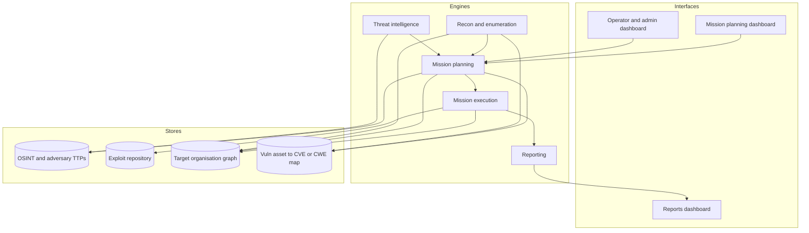

---

## 2. Master mission workflow (closed loop)

Deck page 12 (left) made continuous: execution can loop back for more recon or a re-plan, and repeats until the objective is met. RoE plus human approval gate sits before execution.

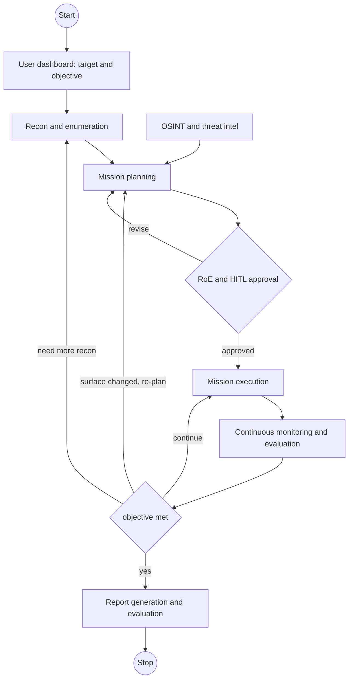

---

## 3. Threat intelligence internal flow

Deck page 13 (right) expanded with an online vs air-gapped update-mode switch, TTP extraction, and provenance/trust scoring before publishing to the OSINT store.

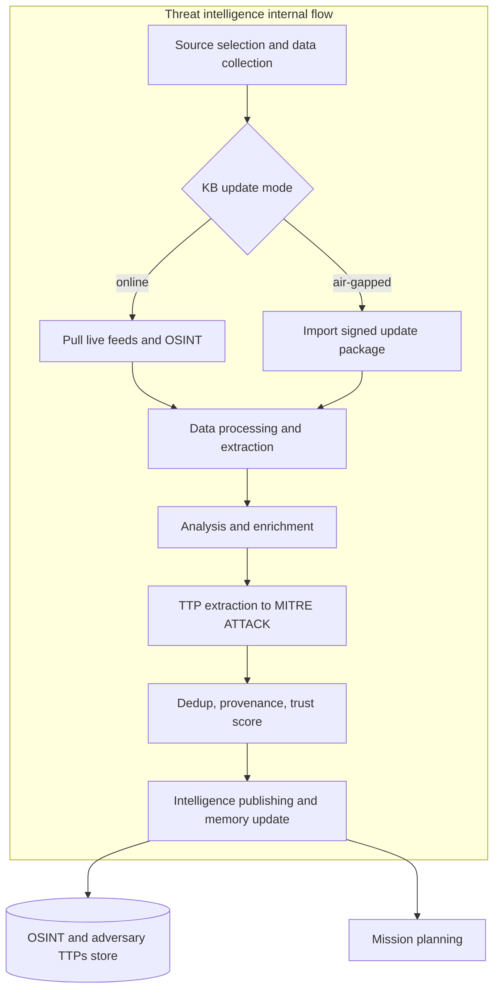

---

## 4. Recon and enumeration internal flow

New detail: layered discovery (L2 to L7), RoE-gated active scanning, assumption nodes for what cannot be confirmed, bitemporal writes to the org graph. Re-invoked whenever execution finds a new host or segment.

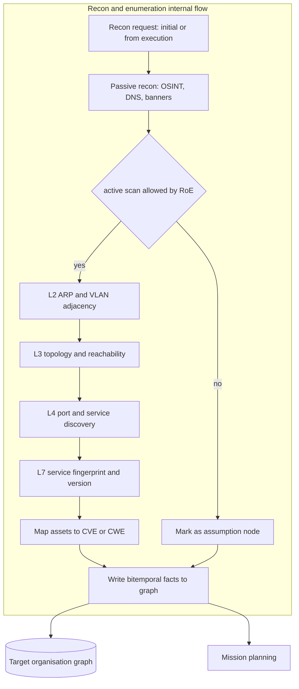

---

## 5. Mission planning internal flow

Deck page 12 (right) expanded neuro-symbolically: LLM backend is selectable; hypotheses are verified against the belief state; unknown preconditions spawn assumption nodes that call recon back.

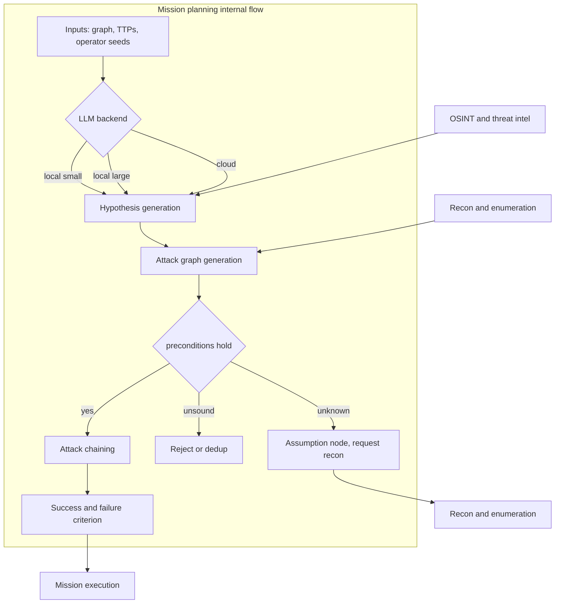

---

## 6. Hypothesis generation (sub-flow)

Zoom into the first planning box. Three hypothesis sources feed one pool: auto-derived, operator-seeded (threat actor profile), and operator-injected (manual). Pool is scored and ranked.

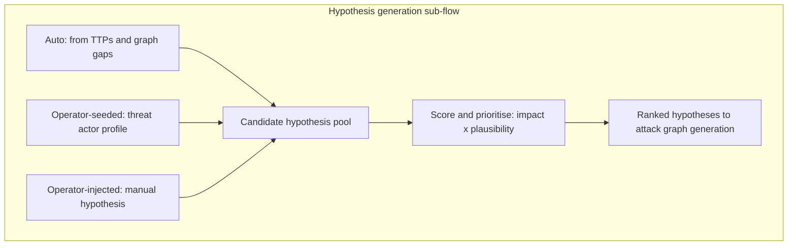

---

## 7. Attack graph generation and verification (sub-flow)

Zoom into the second planning box. Each hypothesis is checked for preconditions and logical soundness; missing facts become recon tasks, verified steps extend the attack graph with coverage accounting.

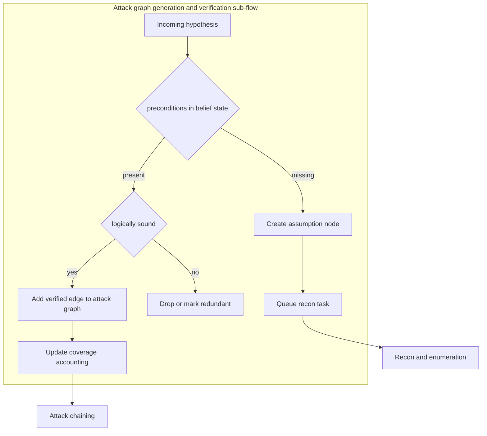

---

## 8. Mission execution internal flow

Deck page 13 (left) corrected. The loop is no longer a dead end: it can call recon for more information or send a re-plan to mission planning. Execution mode (emulated vs real) and the autonomy/HITL gate are explicit.

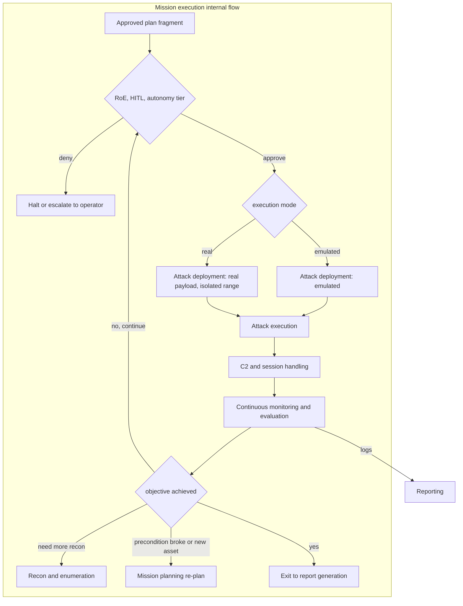

---

## 9. Attack deployment (sub-flow)

Zoom into deployment. If no reliable payload exists it is built and verified in an isolated VM before use; the emulated vs real switch decides how the action actually runs. Reads and updates the exploit repository.

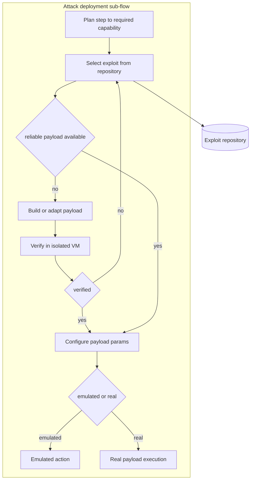

---

## 10. Reporting and evaluation internal flow

Deck's Report Generation and Evaluation expanded: logs and the attack graph become metrics (coverage, time, detection signal) plus compliance checks, rolled into a posture summary and artefacts.

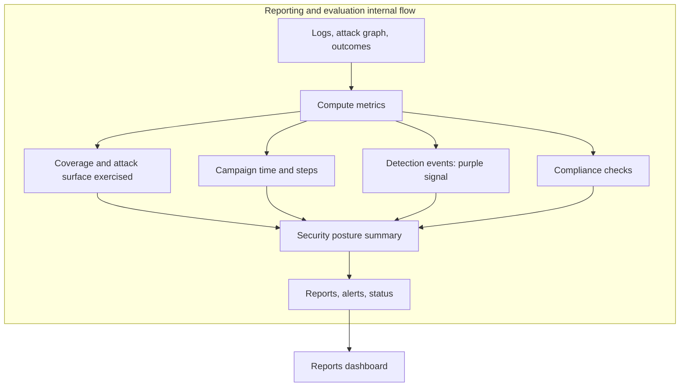

---

## 11. HITL and autonomy decision (cross-cutting)

How any state-changing action is routed. The deck lists HITL approvals as mandatory; this shows it as a gate combining autonomy tier and RoE. Irreversible or out-of-scope actions are denied or escalated.

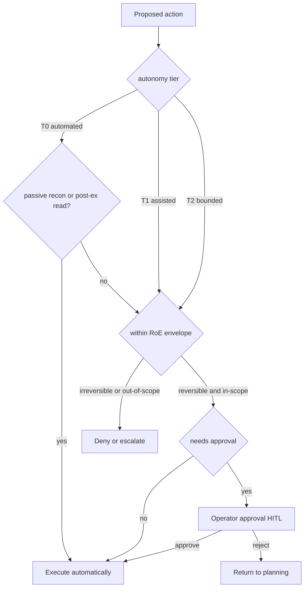

---

## 12. Configurability overview

The four operator switches and which engines each one affects. This is the 'nor is configurable' gap made explicit: model backend, execution mode, autonomy tier, and KB update mode.

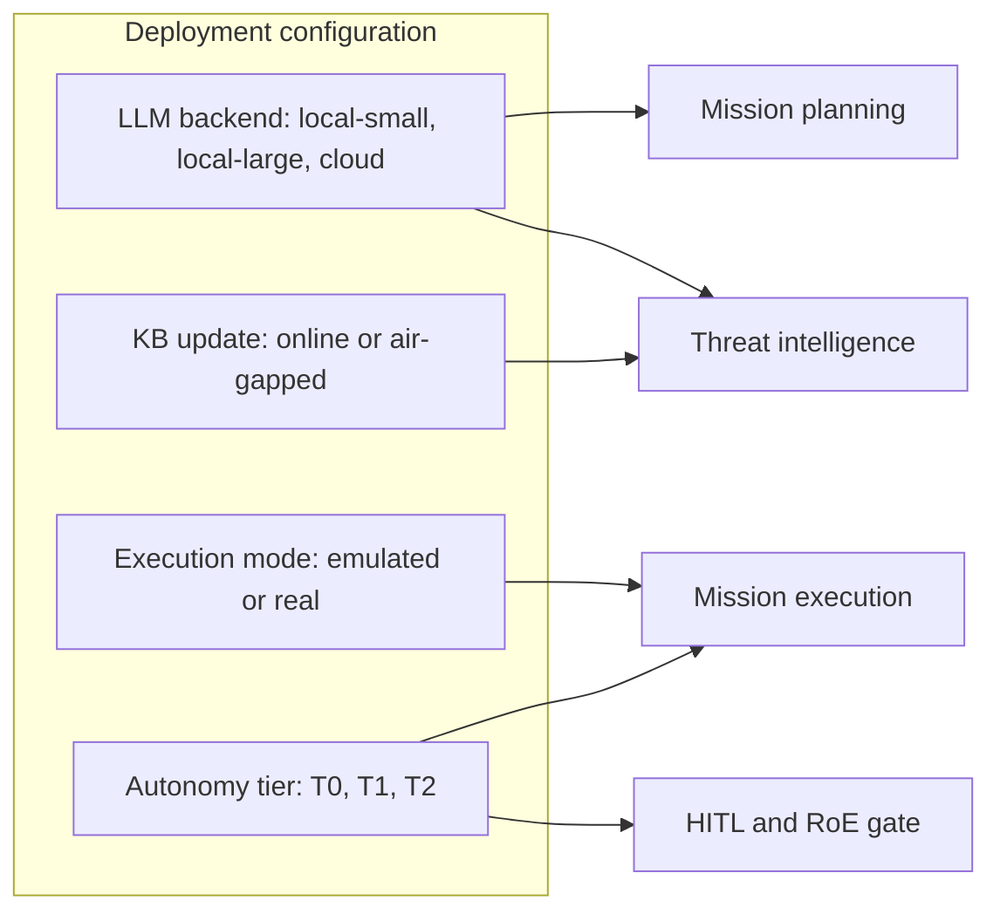

---

## 13. Stores and data relationships

The four deck stores and how they reference each other. Graph assets key into the CVE/CWE map, which keys into the exploit repository. Every graph fact is bitemporal (valid_from plus observed_from).

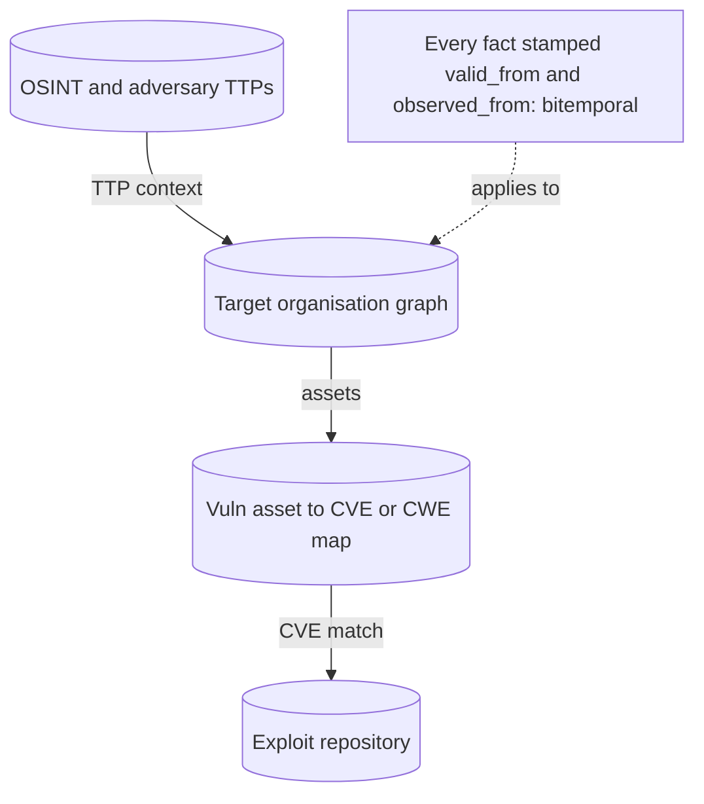

---
